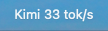
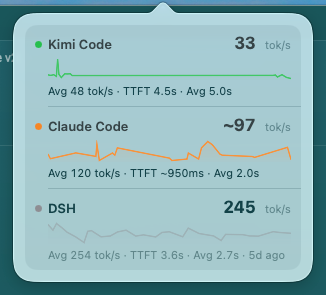

# toks

A macOS menu bar widget that shows live LLM performance — **TTFT** and **decode tok/s** (latest + rolling average) — for every coding agent you use, in one place.





```
┌─ Toks ─────────────────────────────────────┐
│ ● Kimi Code                       33 tok/s │
│    ▁▂▁▁▁▁▁▁▁▁▁▁▁▁▁▂▂▃▂▁▁▁▁▁▁▁▁               │
│    Avg 48 tok/s · TTFT 4.5s · Avg 5.0s     │
│ ● Claude Code                    ~97 tok/s │
│    ▁▂▃▅▂▃▄▃▃▄▄▃▃▄▄▅▄▅▄▅▅▄▅▄▃▁               │
│    Avg 120 tok/s · TTFT ~950ms · Avg 2.0s  │
│ ● DSH                           245 tok/s  │  (dimmed = stale)
│    Avg 254 tok/s · TTFT 3.6s · 5d ago      │
└─────────────────────────────────────────────┘
```

The menu bar shows the first visible agent's name + latest tok/s (e.g. `Kimi 33 tok/s`). Click it for the dropdown: every agent with data gets a live tok/s sparkline (hover for per-sample values), rolling averages, and TTFT. `~` marks approximate values. Rows dim and show an age (`5d ago`) when an agent goes idle — the layout never collapses.

Right-click the menu bar item for **Refresh Now**, **Pause Refresh**, **Settings…** (refresh interval 1s/2s/5s, drag-to-reorder agents, visibility toggles) and **Quit**. Settings persist to `~/.local/share/toks/settings.json` and apply live.

## How it works

```
agent session files ─┐
  kimi  wire.jsonl   ─┤
  claude transcripts ─┤
  codex  rollouts    ─┤  collector (bun)      stats.json ──▶ Toks.app (menu bar)
  dsh    .jsonl.zstd ─┤  tails / polls        every 1.5s      re-reads every 1s
  zcode  db.sqlite   ─┤  every 1.5s
  pi     extension push (adapters/pi) ────────▶ events/*.jsonl
```

No agent configuration is modified except pi (one extension file) — everything else is read-only tailing of files the agents already write.

## Per-agent data sources and accuracy

| Agent | Source | TTFT | tok/s | Notes |
|---|---|---|---|---|
| Kimi Code | `~/.kimi-code/sessions/**/wire.jsonl` `step.end` | exact | exact | `llmFirstTokenLatencyMs` / `llmStreamDurationMs` |
| DSH | `~/.dsh/sessions/**/session.v4.jsonl.zstd` | exact | exact | dispatch record `time` → first chunk `time0` → last chunk |
| ZCode | `~/.zcode/cli/db/db.sqlite` `model_usage` | exact | exact | native `time_to_first_token_ms` |
| pi | `~/.pi/agent/extensions/toks-reporter.ts` push | exact | exact | same anchor logic as the statusline extension |
| Claude Code | `~/.claude/projects/**/​*.jsonl` | approx | approx | no timing fields on disk; reconstructed from block timestamps and `thinkingDurationMs` (first token ≈ block0 end − thinking time), main thread only (`isSidechain` excluded), capped at 250 tok/s |
| Codex | `~/.codex/sessions/**/rollout-*.jsonl` | exact (turn-level) | approx | `task_complete.time_to_first_token_ms`; tok/s uses turn duration which includes tool time, so it reads low |
| agy (Antigravity) | — | — | — | unsupported: session store is encrypted protobuf, logs carry no timing |

Semantics: one sample per completed LLM response. `tok/s` = output tokens ÷ decode time (excludes TTFT). Averages are arithmetic means over the last 200 samples per agent, persisted in `state.json` across restarts. Samples merge across concurrent sessions/subagents of the same agent; the per-agent window is kept time-sorted so the sparkline and latest value always reflect chronology.

## Install

```sh
sh scripts/install.sh
```

Builds `Toks.app` into `~/Applications`, registers the collector as a launchd agent (`com.reedchan.toks.collector`), installs the pi extension, and launches the app. pi picks up the extension on its next start.

Uninstall (keeps metrics history in `~/.local/share/toks/`):

```sh
sh scripts/uninstall.sh
```

## Develop

- Collector: `bun collector/src/main.ts` (foreground, logs to stdout). Env knobs: `TOKS_ACTIVE_MS` (how far back file discovery looks, default 30 min), `TOKS_ZCODE_SINCE_MS` (zcode backfill window at startup).
- App: `sh menubar/build.sh` → `menubar/build/Toks.app`; `sh menubar/build.sh debug` builds a windowed variant for inspecting the UI without the menu bar.
- Logs: `~/.local/share/toks/collector.log`; state: `~/.local/share/toks/{stats.json,state.json}`.

## Requirements

macOS 13+, Command Line Tools (swiftc), bun, zstd, sqlite3.

## License

[MIT](LICENSE)
